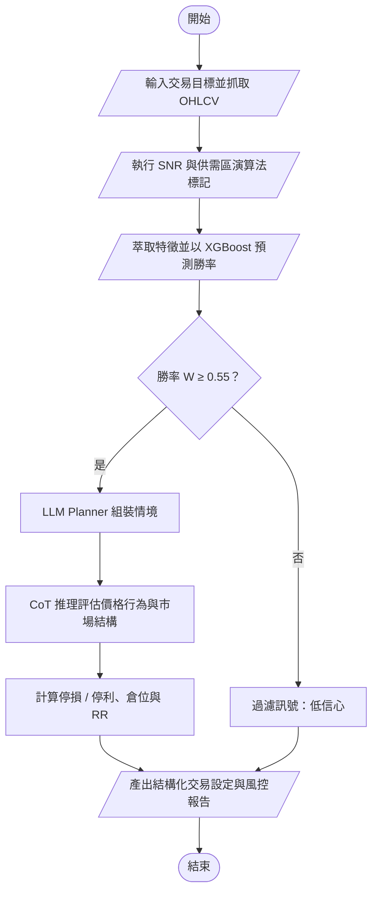

# DESIGN.md — Hybrid TPA-Agent

> 本文件是系統設計的**入口與索引**。依期末專題規範，DESIGN.md 需讓其他人理解
> Problem → Requirements → Architecture → Components → Data → AI/Analytics → Domain Knowledge → Algorithm → Implementation → How to Run → Results。
>
> 本專題採 **OpenSpec 規格驅動開發**：設計細節的單一事實來源在 `openspec/`，本文件只摘要並指向對應位置，避免兩份文件內容不同步。
>
> 狀態：**Proposal 階段**（尚未實作）。

| 章節 | 狀態 | 詳細內容位置 |
|---|---|---|
| 1. Problem | ✅ | [docs/proposal/01-introduction.md](docs/proposal/01-introduction.md)、[00-core-definition.md](docs/proposal/00-core-definition.md) Part 1 |
| 2. Requirements | ✅ | [openspec/changes/add-hybrid-tpa-agent-core/specs/](openspec/changes/add-hybrid-tpa-agent-core/specs/)（8 個 capability） |
| 3. Architecture | ✅ | [design.md](openspec/changes/add-hybrid-tpa-agent-core/design.md) Context |
| 4. Components | ✅ | 下方模組對照表 |
| 5. Data | ⏳ 市場與期間待定 | [design.md](openspec/changes/add-hybrid-tpa-agent-core/design.md) Open Questions |
| 6. AI / Analytics | ✅ | [design.md](openspec/changes/add-hybrid-tpa-agent-core/design.md) D1、D3 |
| 7. Domain Knowledge | ✅ | [00-core-definition.md](docs/proposal/00-core-definition.md)、[price-action-knowledge-base spec](openspec/changes/add-hybrid-tpa-agent-core/specs/price-action-knowledge-base/spec.md) |
| 8. Algorithm | ⚠️ 待小組決議 | 原 Pseudocode 見 [docs/original/](docs/original/)；不一致處見 design.md「待小組決議事項」 |
| 9. Implementation | ⏳ | [tasks.md](openspec/changes/add-hybrid-tpa-agent-core/tasks.md)（27 項） |
| 10. How to Run | ⏳ | 實作後補上 |
| 11. Results / Limitations | ⏳ | 實作後補上（`docs/results/`） |

## 1. 一句話說明

演算法負責精確，機器學習負責機率，LLM 負責情境，風控負責說不，人負責按下確認。

## 2. 模組對照表

| 模組 | 名稱 | OpenSpec capability | Core | Detail |
|---|---|---|---|---|
| 1.1 | User Preference Block | `user-preference` | C4 | D1 |
| 1.2 | Data Ingestion Engine | `market-data-ingestion` | C5 | D2、D10 |
| 2.1 | Deterministic S&D Zone Engine | `supply-demand-zone-detection` | C1 | D3 |
| 2.2 | ML Win-Rate Engine | `win-rate-prediction` | C2 | D4、D5 |
| 3.1 | Domain Knowledge Base | `price-action-knowledge-base` | C3 | D6 |
| 3.2 | Planner & Reasoning Agent | `planner-reasoning-agent` | C3 | D7 |
| 4.1 | Decision & Risk Engine | `trade-decision-risk` | C4 | D8、D9 |
| 4.2 | Output & Report Interface | `trade-report-output` | C5 | D10 |

## 3. 決策流程（摘自原 Proposal 流程圖）

> 注意：此流程圖與原 Pseudocode 的門檻判斷順序不同，見 design.md「待小組決議事項」Q3。
