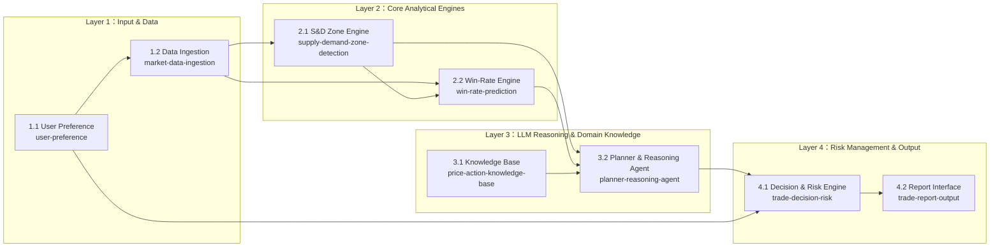

# Design

## Context

本設計由小組 Proposal 第 4 章（System Architecture & Modules）、第 5 章（Pseudocode）、決策流程圖與架構圖轉換而來（原檔見 `docs/original/`）。動機見 proposal.md，各模組的行為規格見 `specs/`，五個核心能力與十個設計細節的定義見 `docs/proposal/00-core-definition.md`。

目前狀態：尚無程式碼。市場、標的、時間框架與回測期間尚未決定。

### 四層八模組架構



### 資料流（一次分析）

```text
使用者設定 (S, TF, 風險%)
  → OHLCV + 品質旗標
  → 供需區清單 [{上緣, 下緣, 類型, 形成時間, 測試次數}]
  → 特徵向量 → 勝率 W
  → 結構化情境 JSON {現價, 供需區, W, 相關規則}
  → LLM 情境判斷 + 推理理由 + 規則識別碼
  → 停損 / 停利 / RR / E / 倉位 → 門檻判斷
  → 結構化報告（APPROVED 或 WAIT／NO_TRADE）→ 交易者確認
```

## Goals / Non-Goals

**Goals:**
- 每個模組都有獨立、可測試的責任邊界，對應一個 OpenSpec capability。
- 所有數值（供需區、勝率、停損、停利、RR、E、倉位）都由確定性程式或 ML 模型產生，可重現、可追溯。
- 回測流程不使用任何決策時間點之後的資料。

**Non-Goals:**
- 不做自動下單或與券商交易系統整合（第一版只輸出建議報告）。
- 不處理新聞、總經等非價量資料（原 Proposal Q10 提到的新聞感知列為未來工作）。
- 不做多標的投資組合管理。

## Decisions

### D1. 數值與語意解耦（Core C3）
- **選擇**：供需區、勝率、停損停利、RR 皆由確定性程式或 ML 模型計算；LLM 只接收結構化 JSON，輸出情境判斷與理由。
- **理由**：原 Proposal Q3-7 已論證 LLM 不擅長浮點數與空間座標運算；文獻也顯示 LLM 的數值與機率不可靠 [14]，且回測績效易受記憶影響 [15]–[18]。
- **替代方案**：讓 LLM 直接讀 K 線圖並給出價位（如多模態方法 [11]）。缺點是無法保證可重現，也難以排除記憶效應。

### D2. 以區域而非水平線表示結構（Core C1）
- **選擇**：供需區以上緣、下緣表示，並追蹤測試次數與角色轉換。
- **理由**：停損需要放在「區域外側」，水平線無法提供這個資訊；這也是本專題與既有 S/R 研究 [7], [8] 的主要差異。
- **替代方案**：Pivot Points 或 KDE 產生的價格水平線。

### D3. XGBoost 作為勝率模型（Core C2）
- **選擇**：使用梯度提升樹處理結構化特徵，標籤採「N 根 K 棒內先觸及停利或停損」的 barrier 定義 [6]。
- **理由**：XGBoost 在結構化技術特徵上表現穩定 [9]，且可輸出機率並分析特徵重要度，方便解釋。
- **替代方案**：LSTM／Transformer 等序列模型。資料量有限時較易過擬合，也較難解釋。

### D4. 雙門檻 + 期望值的決策規則（Core C4）
- **選擇**：W ≥ 0.55 且 RR ≥ 2.0 才輸出 APPROVED，並計算 E = W×RR − (1−W) 供參考。
- **理由**：準確率高不等於獲利 [7]，必須同時考慮勝率與風報比。
- **替代方案**：只以 E > 0 判斷。缺點是可能接受勝率很低、RR 極高的訊號，造成連續虧損。

### D5. Human-in-the-Loop 與分級降級（Core C5）
- **選擇**：系統只產生建議報告；資料延遲 > 2 秒時凍結新訊號，中斷 > 30 秒時發出熔斷警報。
- **理由**：對應原 Proposal 爭論一的立場，以及 Q3-8 的降級協議。

## Risks / Trade-offs

- [供需區參數（回看長度、成交量門檻）影響很大] → 在訓練期間做參數敏感度分析，測試期間固定參數。
- [勝率模型過擬合歷史行情，遇到市場狀態轉換時失準（Q3-10）] → 時間序列切分、walk-forward 驗證，並報告校準度。
- [LLM 可能記得歷史行情，使回測高估] → LLM 不產生價格或勝率；測試期間盡量選在 LLM 知識截止日之後 [17], [18]。
- [門檻過嚴導致交易次數過少（Trade-off T1）] → 回報不同門檻下的訊號數量與期望值曲線。
- [LLM 呼叫成本與延遲] → 只在通過初步篩選的候選訊號上呼叫 LLM；記錄每次分析的呼叫次數。
- [低流動性時段的假失衡 K 棒（Q3-4）] → 資料品質旗標加入成交量異常檢查。

## Migration Plan

新系統，無遷移需求。實作順序見 tasks.md：資料層 → 供需區 → 勝率模型 → 知識庫與推理 → 風控 → 報告 → 回測評估。

## 待小組決議事項（原 Proposal 的不一致之處）

以下是將原 Proposal 轉為規格時發現的不一致。依小組決定，本次**不修改**原 Pseudocode、Flowchart 與 Q3 內容，先記錄在此。`specs/` 目前依「模組說明（第 4 章）」與「核心思維」撰寫；若小組決議不同，修改對應的 spec 即可。

| # | 不一致之處 | 原文件位置 | 目前 spec 的寫法 | 需要決定的事 |
|---|---|---|---|---|
| Q1 | 誰計算停損與停利？模組 4.1 說由風控引擎依供需區邊界計算，Q3-7 也主張 LLM 不做數值計算；但 Pseudocode 第 15–20 行由 `PlannerAgent.reason()` 產生 `recommended_stop_loss`、`recommended_take_profit` | 第 4 章、Q3-7 vs. 第 5 章 | 由 `trade-decision-risk` 計算 | 是否將 Pseudocode 改為由 Risk Engine 計算 |
| Q2 | 勝率 W 的來源：Pseudocode 第 17 行檢查的是 `evaluated_plan.win_probability`（LLM 輸出），而非 XGBoost 直接輸出的值 | 第 5 章 | W 由 `win-rate-prediction` 產生，LLM 不得改變（`planner-reasoning-agent`） | 是否改為直接使用 ML 輸出的 W |
| Q3 | 門檻判斷的順序：流程圖在呼叫 LLM **之前**先檢查勝率門檻；Pseudocode 在 LLM **之後**才同時檢查 W 與 RR | 流程圖 vs. 第 5 章 | 未規定順序，只規定最終決策條件 | 是否先篩 W 再呼叫 LLM（可節省 LLM 成本） |
| Q4 | 倉位計算：Mindset 4 與模組 4.1 提到倉位，但 Pseudocode 沒有計算倉位，也未使用模組 1.1 的風險設定 | 第 3、4 章 vs. 第 5 章 | 由 `trade-decision-risk` 依風險設定計算 | 是否在 Pseudocode 加入倉位計算 |
| Q5 | Q3-8 的 Level 2（在交易所預掛硬性停損）與 Level 3（強制市價平倉）需要下單能力，與 Human-in-the-Loop 立場及無下單模組的架構不符 | Q3-8 vs. 爭論一、第 4 章 | 第一版不送出任何委託，只發出警報 | 是否將下單功能列為未來工作 |
| Q6 | Q3-10 依賴「LLM 外部新聞感知」處理黑天鵝事件，但資料層只有 OHLCV，沒有新聞來源 | Q3-10 vs. 第 4 章 | 列為 Non-Goal | 是否在架構中加入新聞資料來源 |
| Q7 | 模組 1.2 提到 Volume Profile（逐價成交量），但一般 OHLCV 資料無法計算 | 第 4 章 | 只要求 OHLCV | 是否改用 K 棒成交量近似，或取得逐筆資料 |

## Open Questions

以下參數可在實作期間決定，不影響規格與任務拆分：
- 市場、標的、時間框架與回測期間。
- Swing 偵測回看長度、成交量確認門檻、ATR 緩衝倍數、標籤的 N 值。
- 使用哪一個 LLM 與行情資料來源。
